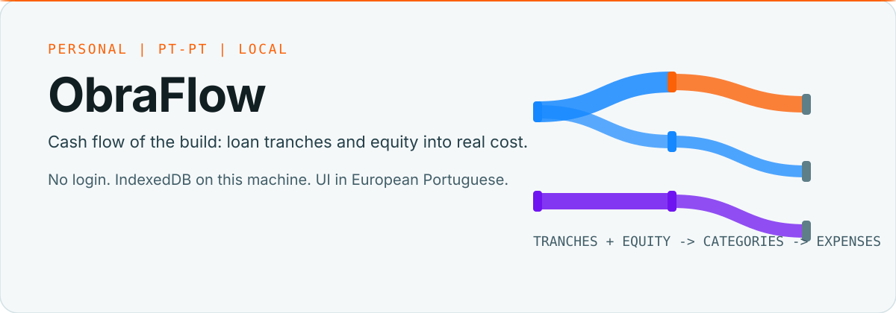
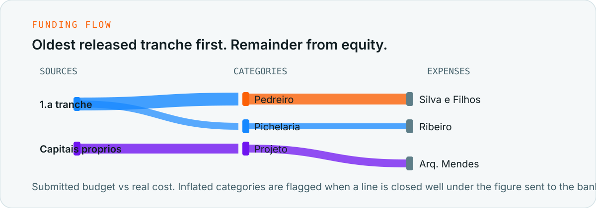

Local monitor for a construction budget. Bank loan tranches and equity (capitais próprios) feed budget categories, then actual expenses. The dashboard is a Sankey diagram. There is no account and no splash screen. Everything stays in IndexedDB on this machine.

UI copy is European Portuguese. Code, comments and identifiers are English.



## What it does

- Maps cash flow: released tranches, then equity if a tranche is empty or not yet released
- Compares submitted budget vs real cost, including categories padded for credit approval
- Warns when a category overruns or equity falls below a threshold
- Accepts PDF/invoice uploads, extracts fields, and waits for a manual confirm before writing expenses
- Exports CSV or PDF for the bank


```bash
npm install
npm run dev
```

Open [http://localhost:5174](http://localhost:5174). First launch seeds a fictional obra so the Sankey is not empty.

```bash
npm test
npm run lint
npm run build
```


| Path | Role |
|------|------|
| `src/domain/` | Pure logic: cashflow, variance, alerts, Sankey graph |
| `src/services/` | Dexie, document parsing, CSV/PDF export |
| `src/components/` | JSX only; styles in `*.module.css` |
| `src/i18n/pt-PT.ts` | All visible strings |
| `src/styles/tokens.css` | Coreflux DESIGN.md semantic tokens |

Stack: React 18, Vite, TypeScript, Dexie, d3-sankey, CSS Modules. Visual language matches FluxMES (Abyss surfaces, Flare actions, Space Grotesk / Plus Jakarta Sans / Space Mono).
